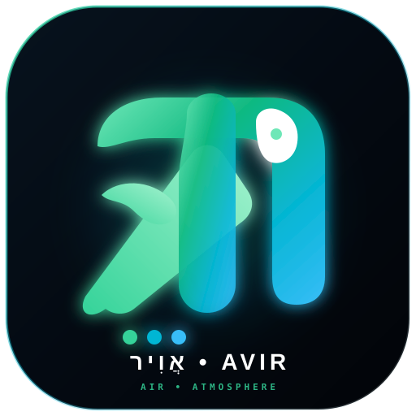
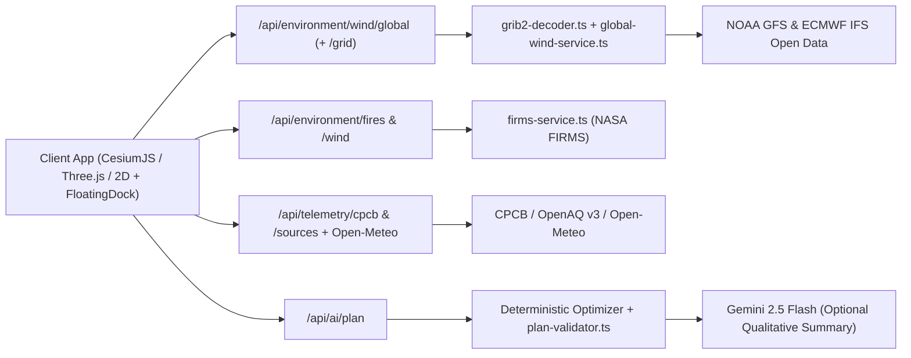

<div align="center">



# Avir

**Turning Atmospheric Intelligence Into Everyday Action.**

Avir is an open-source atmospheric intelligence platform that combines interactive 3D Earth visualization, live environmental observations, scientific exposure modeling, and AI-assisted explanations to help people make more informed air-quality decisions.

[](https://github.com/XiaoArnav/avir/actions/workflows/ci.yml)
[](LICENSE)
[](https://nextjs.org/)
[](https://www.typescriptlang.org/)
[](https://cesium.com/)

**[Launch Live Demo](https://avir-blue.vercel.app)** · **[Try Avir in 30 Seconds](#try-avir-in-30-seconds)** · **[Explore Source Code](https://github.com/XiaoArnav/avir)** · **[API Reference](#api-reference)**

</div>

---

## Experience Avir

Open **[avir-blue.vercel.app](https://avir-blue.vercel.app)** to launch the **Earth Command Center** directly in your browser—zero account signup or API keys required for core telemetry.

> **Workspace Walkthrough Showcase:** Navigation centers around a live planetary globe paired with a persistent bottom mission dock (`FloatingDock`) across five specialized workspaces:

| Surface | Live Interactive Experience |
| :--- | :--- |
| **Earth Command Center** | Launches on **CesiumJS** satellite Earth (`Esri World Imagery` with `OpenStreetMap` fallback), switches cleanly to **Three.js** (`NASA Blue/Black Marble`), or collapses to an accessible **2D Station Map & Ledger** while preserving active telemetry and layers. |
| **Environmental Layers Panel** | Toggle four live planetary overlays from the toolbar: **Global Wind Flow** (`NOAA GFS` & `ECMWF IFS` GPU streamlines + scalar drapes), **Active Fires** (`NASA FIRMS`), **3D Terrain Mesh** (`Re:Earth` quantized mesh), and the **NASA GIBS** Before/After Satellite Comparison modal. |
| **Multi-Workspace Mission Dock** | Move seamlessly across **Air Quality**, **World Data** (`35` tracked global metros), **Daily Plan** (inhaled-dose routine optimizer), **Clean Home** (`IAQStudio` purifier & Corsi-Rosenthal Box calculator), and **Community** (CAQM NCR advisories & school/society guidance). |

---

## The Problem

Most air-quality apps stop at showing a single static number and a generic color warning. That tells people *the air is bad*, but leaves everyday decisions unanswered:

- *Is that reading from a calibrated physical ground monitor or an atmospheric forecast grid?*
- *Where are local wind currents and nearby thermal hotspots pushing surface smoke right now?*
- *How much PM2.5 mass will an evening run actually put into my lungs compared to shifting that workout indoors or into afternoon solar mixing hours?*

## The Avir Approach

Avir connects raw atmospheric science to daily human decisions through five transparent steps:

1. **Environmental Observations & Forecasts** — Separates official regulatory ground stations (`CPCB/CAAQMS`), community/open networks (`OpenAQ v3`, `Sensor.Community`, BYOD `WebSerial`/Wi-Fi hardware), and numerical weather chemistry models (`ECMWF`, `NOAA`).
2. **Interactive Planetary Visualization** — Projects station provenance, animated 10 m global wind streamlines, thermal hotspots, terrain elevation, and orbital true-color reflectance on a single interactive Earth.
3. **Deterministic Exposure Physics** — Quantifies inhaled fine-particulate mass (`µg`) across microenvironments, commute modes, respirator masks, and indoor air-change clearance curves.
4. **Actionable Everyday Planning** — Shifts flexible daily activities toward cleaner planetary boundary-layer dispersion windows and sizes residential filtration to room geometry.
5. **Clear AI-Assisted Interpretations** — Uses **Gemini 2.5 Flash** solely to explain validated physical results in calm, accessible language—never to guess sensor values or override physics.

---

## What Avir Can Do

| Domain | Capabilities Implemented | Availability & Honest Constraints |
| :--- | :--- | :--- |
| **Interactive Planet** | **CesiumJS** default 3D satellite Earth, toggleable/automatic **Three.js** WebGL globe (`three-camera-controller.ts` isolated zoom/pinch), and **Accessible 2D Map** with sortable station ledger (`10` quick metro pills + global search). | 3D globes require WebGL; state & wind fields persist across `CESIUM` ↔ `THREE` ↔ `2D MAP` switches. |
| **Global Wind Intelligence** | Animated GPU streamlines from **NOAA GFS `0.25°`** (`00/06/12/18z`) and **ECMWF IFS `0.25°`** (`00/12z` & `06/18z`) via a pure-TS GRIB2 pipeline, plus `Speed`, `2 m Air Temperature`, and `MSL Pressure` overlays (`km/h`, `m/s`, `mph`), pause control, and click-to-inspect vectors. | Supports `-24h` historical cycle matching up to `+384h` (GFS) / `+360h` (IFS `00/12z`; `+144h` on `06/18z`); falls back explicitly to regional Open-Meteo `best_match` probes or `unavailable` states on upstream outages. |
| **Air Quality Intelligence** | Live toggle between **Indian CPCB NAQI** (8-pollutant statutory index) and **2024 US EPA PM2.5 NAAQS** (`40 CFR Part 58 App G`), multi-source inspector, **5 Source Control modes**, freshness badges, and BYOD monitor support (**AirGradient ONE / Open Air**, **Project Vaayu**) with Barkjohn RH correction. | Ground feeds (`CPCB`, `OpenAQ v3`) activate when optional server keys are configured; otherwise operates on open **Open-Meteo (ECMWF CAMS/IFS)** baseline without fabricating station data. `WebSerial` requires Chrome/Edge/Opera. |
| **Satellite and Fire Intelligence** | **NASA FIRMS** `VIIRS NOAA-20` 375 m trailing-24h thermal anomalies (`1–1,000 km`), **NASA GIBS** Before/After comparison slider (`VIIRS NOAA-21` True Color & `HLS Sentinel-2` 30 m NBAR), and **Re:Earth / Mapterhorn** quantized-mesh 3D terrain in CesiumJS. | FIRMS works **keyless** via regional 24h CSV archives (with `Global` ocean/border fallback) or with optional `FIRMS_MAP_KEY`. Optical imagery visualizes surface reflectance/smoke rather than measuring ground PM2.5, and cloud cover can obscure swaths. |
| **Daily Exposure Planning** | Discrete-time inhaled PM2.5 dose engine, customizable **Daily Schedule Builder** (`≤ 15` activities), forecast-driven **Routine Shifter**, **Diurnal BLH Scrubber**, **City Smog Shootout**, **Commute Calculator**, and **Mask & HEPA Lifespan Checker**. | Ventilation rates (`0.008–0.045 m³/min`) model average ~70 kg adult profiles from the US EPA Exposure Factors Handbook (2011) alongside editable microenvironment assumptions. |
| **Clean Home** | **IAQ Engineering Studio**: Air Changes per Hour (`ACH`), exponential well-mixed decay half-life clearance, metric/imperial room sizing, 5 cleaner presets (including **4-Filter & 5-Filter Corsi-Rosenthal Boxes** and commercial HEPA), and customizable INR Bill of Materials. | Assumes a well-mixed indoor air volume without accounting for unmodeled continuous infiltration leaks or outdoor door openings. |
| **Community Intelligence** | Jurisdiction-aware **CAQM GRAP** regulatory status resolver for Delhi-NCR alongside structured **RWA Bulletin** and **School Safety Advisory** generators (`ShareBulletinModal`). | Strictly enforces administrative NCR jurisdiction checks (`Not Applicable` outside NCR) and never infers legally binding GRAP stages from raw numeric AQI alone. |
| **AI-Assisted Explanations** | `POST /api/ai/plan` pairs deterministic schedule optimization with qualitative **Gemini 2.5 Flash** situation summaries and plain-language health context. | Optional server `GEMINI_API_KEY`; automatically falls back to deterministic structured explanations if unset, timed out (`8s`), or if output guardrails reject numeric alterations or medical claims. |

---

## Try Avir in 30 Seconds

1. **Open the live app** at **[avir-blue.vercel.app](https://avir-blue.vercel.app)** — CesiumJS loads Earth automatically with **Air Quality** active.
2. **Select any city** using the bottom metro strip (`Delhi-NCR`, `Bengaluru`, `Mumbai`, `Beijing`, etc.) or search globally under **Target Global Air Station**.
3. **Inspect telemetry & provenance** by toggling **CPCB / EPA** in the active city card, clicking the active **Data Source** badge to switch sources, or opening **View Environmental Details**.
4. **Explore live Earth layers** via the **LAYERS** button on the globe toolbar (`Wind Flow`, `Active Fires`, `3D Terrain`, and `Satellite Imagery` Before/After slider), or toggle **`CESIUM` ↔ `THREE`** and **`3D` ↔ `2D MAP`**.
5. **Test personal impact tools** on the bottom mission dock: open **Daily Plan** to optimize activity hours against the 24-hour forecast, or **Clean Home** to size a DIY Corsi-Rosenthal Box for your room.

---

## Under the Hood

- **Dual-Engine Planetary Rendering**: `AvirGlobe` orchestrates `AvirCesiumGlobe` (default photorealistic satellite tiles + Re:Earth quantized terrain) and `AvirGlobeCanvas` (`Three.js` + Rayleigh atmospheric rim shader + isolated camera wheel/pinch controls), falling back automatically from CesiumJS -> Three.js -> `AccessibleEarthFallback` 2D map when WebGL features degrade.
- **Pure-TypeScript Serverless GRIB2 Pipeline**: `grib2-decoder.ts` parses NOAA GFS (`Template 5.3` complex packing & spatial differencing) and ECMWF IFS (`Template 5.42` CCSDS 121.0-B-3 lossless entropy coding) directly inside Node.js Next.js Route Handlers with zero native C/WASM build dependencies.
- **Binary Transport & Bounded Caching**: `/api/environment/wind/global/grid` streams compact IEEE-754 `Float32Array` fields (`U`, `V`, optional scalar overlay), shared across Cesium/Three engine toggles with subscriber-isolated abort handling and bounded LRU snapshot/alias/backoff caches.
- **GPU-Animated Streamline Shaders**: `cesium-wind.ts` (30°-culled cells) and `three-wind-layer.ts` (sphere-tangent ribbon geometry) animate advection paths on the GPU with backface horizon occlusion, camera-altitude fades, and `prefers-reduced-motion` support.
- **Deterministic Physics First**: `exposure-engine.ts`, `air-math.ts`, `cpcb-naqi.ts`, and `forecast-optimizer.ts` execute all physical calculations deterministically prior to any LLM call.
- **Multi-Source Resilience & Automated CI**: Server routes enforce finite bounds, rate limits, IPv4 retries (FIRMS), and strict error status discrimination, guarded by **Vitest** (`tests/unit`, `tests/integration`, `tests/security`, `tests/a11y`), strict `tsc`, `next build`, and **Playwright** E2E verification.



---

## Built Around Data Transparency

Avir is engineered around explicit epistemic boundaries verified across its domain services (`src/config/environmental-sources.ts`, [GLOSSARY.md](GLOSSARY.md)):

- **Ground Stations ≠ Atmospheric Models**: Physical monitor observations (`observedAt`) and gridded chemical forecasts (`modelValidAt`) are typed separately and flagged in cross-city shootouts (`comparable` checks) rather than blended silently.
- **Forecasts Are Not Live Sensor Readings**: Forecast timeline points carry explicit `isForecast` provenance; modeled concentrations never receive synthetic station multipliers to mimic reference monitors.
- **No Fabricated Fallback Numbers**: Unavailable, stale (`> 24h` age limit), out-of-range (`> 25 km` OpenAQ cap), or unconfigured providers render explicit `unavailable`, `stale_cached`, or `unconfigured` states—while genuine `0 µg/m³` clean-air readings are preserved accurately.
- **Stated Physical Assumptions**: Inhaled PM2.5 mass relies on US EPA (2011) adult ventilation rates and transparent microenvironment infiltration factors (`η_micro`); **Berkeley Earth** cigarette equivalence is explicitly excluded from primary clinical health dosages (`exposure-engine.ts`).
- **Validated AI Boundaries**: `POST /api/ai/plan` strips prompt injections, minimizes personal health flags to sensitivity tiers, rejects LLM responses containing fabricated digits or unsafe medical guarantees, and never relies on AI to perform arithmetic.
- **Not Medical Advice or Emergency Care**: Calculations follow CPCB, 2024 US EPA PM NAAQS, WHO 2021 guidelines, and Corsi-Rosenthal Box fluid dynamics for educational risk mitigation and routine planning only—not as a substitute for clinical diagnosis or emergency medical care.

---

## Google AI in Avir

Avir clearly separates its runtime AI service from the tools used during engineering and testing:

- **Runtime — Gemini 2.5 Flash (`generativelanguage.googleapis.com`)**: Called server-side inside [`POST /api/ai/plan`](src/app/api/ai/plan/route.ts) (`temperature: 0.2`, `x-goog-api-key` header auth, `8s` abort timeout) to convert pre-verified deterministic exposure savings and routine shifts into clear qualitative summaries, with automatic deterministic fallback when unavailable.
- **Development & QA — Google Antigravity**: Used during architecture, debugging, automated Vitest/Playwright verification, and live UI inspection (not a runtime dependency of Avir).
- **Development & Prompt Testing — Google AI Studio**: Used to provision and iterate on `GEMINI_API_KEY` and low-temperature JSON schema instructions during development (not a runtime component).

---

## Technology Stack

| Layer | Technologies (`package.json`) |
| :--- | :--- |
| **Framework & Language** | Next.js `^15.1.0` (App Router, built with `15.5.x`), React `^19.0.0`, TypeScript `^5.7.2` |
| **3D Geospatial & WebGL** | CesiumJS `^1.147.0` (assets synced via `scripts/copy-cesium.mjs`), Three.js `^0.187.0` |
| **UI, Motion & Telemetry** | Tailwind CSS `^3.4.17`, Motion `^14.14.0`, Lucide React `^1.16.0`, `@vercel/analytics` `^2.0.1` |
| **Atmospheric Data & Formats** | Pure-TS GRIB2 (`Template 5.0/5.2/5.3/5.42`), Float32Array binary transport, NOAA GFS, ECMWF IFS & CAMS, NASA FIRMS, NASA GIBS, Re:Earth Terrain, Open-Meteo, OpenAQ v3, India OGD CPCB |
| **Testing & Quality** | Vitest `^3.0.0`, Playwright Test `^1.65.1`, GitHub Actions CI |

---

## API Reference

All Route Handlers live in `src/app/api/` and execute server-side with strict validation:

| Endpoint | Purpose, Validation & Caching |
| :--- | :--- |
| **`POST`** `/api/ai/plan` | Deterministic routine optimization + optional **Gemini 2.5 Flash** summary. IP rate limiter, `100 KB` max JSON body, prompt-injection sanitization, output fabrication/medical guardrails (`plan-validator.ts`), deterministic fallback. |
| **`GET`** `/api/environment/fires` | **NASA FIRMS** active thermal anomalies near `lat`, `lng`, `radiusKm` (`1–1,000`, default `500`). Strict float/bounds checks, `30 req/min` limiter, 30 min cache, keyless `VIIRS_NOAA20_C2_24H` regional CSV archive or optional `FIRMS_MAP_KEY`. |
| **`GET`** `/api/environment/wind` | Regional 3×3 & active-city 10 m wind vectors from Open-Meteo (`best_match`) for `lat`, `lng`, `hour`, `validTimeUtc`. Coordinate/UTC validation, `≤ 1.0°` snap guard, 30 min cache. |
| **`GET`** `/api/environment/wind/global` | Global Wind V2 JSON manifest (`schemaVersion: 2`) for `model` (`gfs` or `ifs`), `overlay`, `validAtUtc`. Selects cycle via `cycleAtOrBefore` (`-24h` to `+384h` GFS / `+360h` IFS), bounded LRU cache, subscriber-isolated aborts. |
| **`GET`** `/api/environment/wind/global/grid` | Float32 binary wind grid (`application/octet-stream`) for `model`, `overlay`, `date`, `hour`, `step`. Synoptic cycle/step validation, server GRIB2 decoding, `s-maxage=3600` / `stale-while-revalidate=7200`. |
| **`GET`** `/api/geo/reverse` | Reverse geocoding for `lat`, `lon` via **OpenStreetMap Nominatim** with predefined fallback. Rounds coordinates to **3 decimals (`~110 m` privacy)**, 24h in-memory cache. |
| **`GET`** `/api/telemetry/cpcb` | Server proxy for India OGD **CPCB / CAAQMS** ground observations (`data.gov.in`). Server-only `DATA_GOV_IN_API_KEY`, strict IST (`UTC+05:30`) parser. |
| **`GET`** `/api/telemetry/sources` | Server proxy for **OpenAQ v3** monitoring stations within `1–25 km`. Server-only `OPENAQ_API_KEY`, preserves native measurement timestamps. |

---

## Local Setup and Environment Variables

### Prerequisites
- **Node.js 20+** and `npm`

### Install & Run Locally

```bash
git clone https://github.com/XiaoArnav/avir.git
cd avir
npm install          # Installs dependencies and runs scripts/copy-cesium.mjs -> public/cesium/
cp .env.example .env.local
npm run dev
```

Open **[http://localhost:3000](http://localhost:3000)**.

### Environment Variables

All external API keys are **strictly server-side** and **optional for local startup**. Without any keys, Avir still serves Open-Meteo atmospheric telemetry, NOAA GFS / ECMWF IFS global wind fields, Re:Earth 3D terrain, NASA GIBS satellite reflectance, keyless NASA FIRMS regional fire archives, and deterministic AI routine optimization:

| Variable | Required? | Purpose |
| :--- | :--- | :--- |
| `OPENAQ_API_KEY` | Optional | Enables authenticated **OpenAQ v3** ground sensor queries (`1–25 km`) |
| `DATA_GOV_IN_API_KEY` | Optional | Enables India OGD (**CPCB / CAAQMS**) official regulatory ground-station feeds |
| `GEMINI_API_KEY` | Optional | Enables **Gemini 2.5 Flash** qualitative explanations in `POST /api/ai/plan` |
| `FIRMS_MAP_KEY` | Optional | Enables direct **NASA FIRMS** `VIIRS_NOAA20_NRT` Area API queries instead of keyless `VIIRS_NOAA20_C2_24H` regional CSV archives |

---

## Testing and CI

The GitHub Actions workflow ([.github/workflows/ci.yml](.github/workflows/ci.yml)) gates pushes and PRs on Node 20:

```bash
npm test                  # Vitest suite: unit, integration, security & a11y tests
npx tsc --noEmit          # Strict TypeScript compiler check
npm run build             # Cesium static asset sync check + Next.js production build
npx playwright install --with-deps chromium && npm run test:e2e
                          # Chromium E2E suite across e2e/*.spec.ts (starts production server on :3000)
```

> **Local E2E Note:** Under heavy multi-core Chromium WebGL contention, you can run Playwright with reduced concurrency (`npx playwright test --workers=2`) or target individual specs (`npx playwright test e2e/globe-platform.spec.ts`). Legacy Python Playwright outage verification helpers remain in `tests/browser/`.

---

## Security and Privacy Architecture

- **Strict CSP & HTTP Security Headers** (`next.config.ts`): Enforces `X-Content-Type-Options: nosniff`, `X-Frame-Options: DENY`, `Referrer-Policy: strict-origin-when-cross-origin`, `Strict-Transport-Security` (`max-age=63072000; preload`), `Permissions-Policy` locking down camera/microphone/payment while permitting self geolocation, `poweredByHeader: false`, and an allowlisted `Content-Security-Policy` for verified atmospheric, tile, terrain, and NASA GIBS origins.
- **Ephemeral Geolocation**: Clicking `Locate Me` resolves session coordinates in memory and never persists raw browser GPS coordinates to `localStorage`; server-side reverse geocoding rounds coordinates to 3 decimals (`~110 m`).
- **Zero Client Secret Exposure**: Keys (`GEMINI_API_KEY`, `OPENAQ_API_KEY`, `DATA_GOV_IN_API_KEY`, optional `FIRMS_MAP_KEY`) stay exclusively on the server, pass via headers (`x-goog-api-key`, never query strings for Gemini), and are scrubbed from error messages. Client-supplied Gemini keys in `/api/ai/plan` request payloads are ignored.

---

## Project Structure

```text
.
├── .github/workflows/ci.yml      # GitHub Actions CI Release Gate
├── .env.example                  # Optional server-side API key template
├── GLOSSARY.md                   # Canonical atmospheric & domain definitions
├── LICENSE                       # MIT License
├── next.config.ts                # Security headers, strict CSP & Cesium webpack rules
├── playwright.config.ts          # Chromium E2E test configuration (:3000)
├── scripts/
│   └── copy-cesium.mjs           # Postinstall Cesium static assets sync -> public/cesium/
├── public/
│   ├── logo.svg                  # Avir brand logomark
│   ├── cesium/                   # Synced Cesium Workers, Assets, Widgets, ThirdParty
│   └── textures/                 # NASA earth-blue-marble.jpg & earth-night.jpg
├── src/
│   ├── app/
│   │   ├── api/                  # 8 server-side Next.js API Route Handlers
│   │   ├── layout.tsx            # Theme shell, metadata & Vercel Analytics
│   │   └── page.tsx              # Main orchestrator connecting workspaces, globes & footer
│   ├── components/
│   │   ├── environment/          # NASA GIBS SatelliteComparisonSlider
│   │   ├── globe/                # AvirGlobe, Cesium (cesium/*), Three.js layers & 2D fallback
│   │   ├── home/                 # EarthCommandCenter, CompactCityCard, EnvironmentalDetailsDrawer
│   │   ├── location/             # Ephemeral FirstVisitLocationModal
│   │   └── ui/futuristic/        # FloatingDock, MissionHeader & aerospace UI primitives
│   ├── config/                   # environmental-sources.ts (eligibility & freshness rules)
│   ├── domain/                   # US EPA / CPCB NAQI math, wind fields & exposure types
│   ├── lib/                      # Cache, circuit breaker, rate-limiter, sanitizer & timezones
│   └── services/                 # FIRMS, GIBS, Global Wind GRIB2, CPCB, OpenAQ, IAQ & GRAP
├── tests/                        # unit/, integration/, security/, a11y/ & browser/ helpers
└── e2e/                          # Playwright E2E specs (globe-platform, source-control, threejs-zoom)
```

---

## Data Sources, Attributions and License

**Created by Arnav Patel (XiaoArnav)** — Originally initiated as an urban air-quality and winter-smog defense assistant and expanded into an open-source planetary environmental platform.

- **Wind Shader & Quantized-Mesh Patterns**: Global GPU streamline shaders and shared-cooldown terrain retry concepts adapted with attribution from the MIT-licensed [God's Eye View](https://github.com/bilawalsidhu/gods-eye-view) architecture by Bilawal Sidhu.
- **Basemap & 3D Terrain**: Tiles © Esri, Maxar, Earthstar Geographics; © OpenStreetMap contributors; Terrain: Re:Earth / Mapterhorn (`CC BY 4.0`).
- **Atmospheric, Satellite & Ground Telemetry**: NOAA NCEP GFS (`Public Domain`), ECMWF IFS & CAMS (`Open Data`), NASA FIRMS & NASA EOSDIS GIBS / Worldview, Open-Meteo, OpenAQ v3, Government of India OGD / CPCB CAAQMS, Sensor.Community.
- **License**: Released under the [MIT License](LICENSE).
