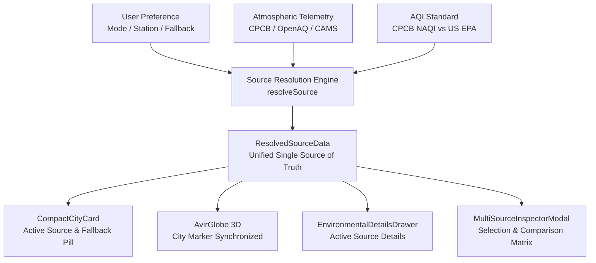

# Avir Source Control: User-Selected Environmental Data Sources & Scientific Audit Engine

## Executive Summary

Avir Source Control introduces an architectural capability for users to inspect, compare, and select the specific environmental observation or modeling source that powers their command center, detailed inspection drawer, and 3D planetary Earth visualization.

Previously, Avir's dashboard primarily presented regional Eulerian atmospheric chemistry simulations (ECMWF CAMS via Open-Meteo) even when high-precision physical regulatory reference monitors (CPCB/CAAQMS) or open physical sensor networks (OpenAQ v3) were operating at breathing height within local proximity. Furthermore, users lacked an interface to choose their preferred source or understand how spatial distance, measurement techniques, and atmospheric dynamics affect observation values.

Avir Source Control solves this by delivering:
1. **5 Transparent Source Selection Modes**: Automatic (Optimal), Official Government Ground (CPCB/CAAQMS), OpenAQ Physical Ground Network, Atmospheric Numerical Model (ECMWF CAMS), and Specific Monitoring Station by ID.
2. **Deterministic Resolution Engine**: Pure, reproducible selection logic with strict spatial boundary enforcement (>100km invalidation when switching cities).
3. **Zero Silent Fallback Policy**: If a preferred station stops reporting or is offline, Avir honestly discloses an unavailable state unless the user explicitly opts into automatic atmospheric model fallback.
4. **Scientific Inter-Source Comparison**: Side-by-side tabular comparison of all active feeds with real-time delta ($\Delta\ \mu\text{g/m}^3$) calculations relative to the active source.
5. **Strict Privacy-Preserving Persistence**: Preferences persist locally via versioned schema (`avir_source_preference_v1`) without storing GPS coordinates or user location history.
6. **Zero Data Fabrication**: Pure public seam adherence; no synthetic 150 values, uncalibrated confidence percentages, or artificial consensus agreements.

---

## Architectural Architecture & Deep Module Design

Following Matt Pocock's Deep Module doctrine (Ousterhout's Razor), Avir Source Control pulls complexity downward into a unified subsystem (`src/services/source-control/`) with a minimal public contract:



### Module Structure
- `src/services/source-control/source-control-types.ts`: Canonical TypeScript type contracts (`SourceSelectionMode`, `SourcePreference`, `SourceResolutionStatus`, `ResolvedSourceData`, `SourceCatalogItem`).
- `src/services/source-control/source-preferences.ts`: Client-side persistence with versioned schema validation (`isValidSourcePreference`, `validateSourcePreference`, `loadSourcePreference`, `saveSourcePreference`, `resetSourcePreference`) and strict privacy guarantees.
- `src/services/source-control/source-resolution.ts`: Pure functional resolution engine implementing deterministic priority, boundary checks, honest disclosures, and mathematical standard calculations.
- `src/services/source-control/source-catalog.ts`: Predefined catalog of recognized providers and physical instrumentation metadata.
- `src/services/source-control/index.ts`: Public module export surface.

---

## Source Selection Modes & Deterministic Priority

| Mode | Key | Primary Target | Proximity Threshold | Fallback Behavior |
| :--- | :--- | :--- | :--- | :--- |
| **Automatic (Optimal)** | `automatic` | CPCB Reference Monitor $\to$ OpenAQ Ground $\to$ CAMS Model | $\le 35\text{ km}$ | Cascades automatically to highest-fidelity available source |
| **Official Government** | `official_ground` | CPCB / CAAQMS / State PCB Regulatory Stations | $\le 35\text{ km}$ | Reports honest `unavailable` unless `allowFallbackToModel` opted-in |
| **OpenAQ Network** | `openaq` | OpenAQ v3 Physical Ground Stations | $\le 50\text{ km}$ | Reports honest `unavailable` unless `allowFallbackToModel` opted-in |
| **Atmospheric Model** | `atmospheric_model` | Open-Meteo ECMWF CAMS Numerical Model | Regional 11km grid | Always available globally; 0 keys required |
| **Specific Station** | `specific_station` | Designated station ID | $\le 100\text{ km}$ of city | Reports `unavailable` if station $>100\text{ km}$ (city switch protection) |

### Zero Silent Fallback Policy
Silent fallbacks deceive users about what kind of measurement they are reading. In Avir:
- When a user chooses **Official CPCB Ground** and no station is reporting PM2.5 in that city:
  - If `allowFallbackToModel: false`: The card displays `Source Status: Offline / Data Unavailable` and AQI displays `--`.
  - If `allowFallbackToModel: true`: The card displays `Fallback Applied: Atmospheric Model Active` with explicit disclosure in both the card and inspector.

---

## Scientific Provider Comparison Table

Section 0 of `MultiSourceInspectorModal` renders a live inter-source matrix comparing all available data feeds for the active city:

| Source & Agency | Type | PM2.5 ($\mu\text{g/m}^3$) | $\Delta$ vs Active | Distance | Observation Timing | Action |
| :--- | :--- | :--- | :--- | :--- | :--- | :--- |
| **Anand Vihar CAAQMS (DPCC)** | Ground | $184.2$ | Active | $8.4\text{ km}$ | Observed 12:00 | *Selected* |
| **US Embassy Diplomatic Post (OpenAQ)** | Ground | $142.0$ | $-42.2\ \mu\text{g/m}^3$ | $4.2\text{ km}$ | Observed 11:45 | `[Select]` |
| **ECMWF CAMS (Open-Meteo)** | Model | $120.5$ | $-63.7\ \mu\text{g/m}^3$ | $0\text{ km}$ | Model Valid 12:00 | `[Select]` |

---

## Privacy-Preserving Persistence Architecture

Avir strictly enforces that user geolocation coordinates are never bundled into preferences:
```typescript
// Persisted Schema in localStorage ('avir_source_preference_v1')
{
  "version": 1,
  "mode": "official_ground",
  "allowFallbackToModel": true,
  "stationId": "cpcb-delhi-anand-vihar",
  "stationName": "Anand Vihar CAAQMS"
  // STRICT INVARIANT: zero latitude, longitude, coords, or gps fields
}
```

---

## Verification Test Matrix

### 1. Unit Tests (`tests/unit/`)
- `tests/unit/source-control-preferences.test.ts` (8 tests):
  - Validates default preferences, schema validation, corrupted JSON resilience, reset handling, and strict zero GPS storage.
- `tests/unit/source-control-resolution.test.ts` (10 tests):
  - Validates Modes A–E deterministic ranking, boundary invalidation (>100km on city switch), explicit fallback opt-in, no silent fallback, CPCB NAQI and US EPA AQI mathematical calculations.

### 2. Integration Tests (`tests/integration/`)
- `tests/integration/source-control-ui.test.tsx` (4 tests):
  - Validates `CompactCityCard` data source link, fallback indicator, unavailable state, and `MultiSourceInspectorModal` Section 0 mode selection rendering.
- `tests/integration/source-inspector.test.tsx` (14 tests):
  - Regression verified: Sections A through E preserved with zero fabrication of 150 values or synthetic consensus.

### 3. Playwright End-to-End Verification (`e2e/`)
- `e2e/source-control.spec.ts` (3 tests):
  - Test 1: CompactCityCard displays active Data Source pill and opens Source Control modal.
  - Test 2: Allows switching data source modes and persists selection to localStorage.
  - Test 3: Fallback toggle, reset defaults, and accessible keyboard Escape navigation work reliably.
- `e2e/globe-platform.spec.ts` (7 tests):
  - Verified 3D globe, diurnal timeline scrubber, theme switching, and bottom metro rail navigation remain completely functional.

### Full Pipeline Run Results
- **TypeScript**: 0 errors (`npx tsc --noEmit`)
- **Vitest**: 83 test files, 1,314 passed (100%)
- **Production Build**: Next.js 15.5 compiled cleanly with static page generation
- **Playwright E2E**: 10 tests passed (100%)
