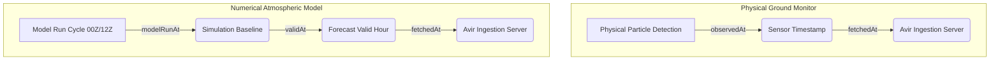

# AVIR — STEP 03 SOURCE INTEGRITY CLOSURE
## Production Data Integrity, OpenAQ v3 Compatibility, Source Provenance, and Scientific Comparison Validation

**Branch:** `fix/avir-03-source-integrity-closure`  
**Base Commit:** `862690d6f983bc67cc7183cc830ad12ea68c3c9b`  
**Pull Request:** `fix(telemetry): correct OpenAQ v3 parsing and eliminate synthetic source comparisons`  
**Author:** `XiaoArnav <322868724+XiaoArnav@users.noreply.github.com>`  

---

## 1. Exact Defects Identified in Step 3 Review

Following the initial merge of Step 3 (PR #8), a rigorous scientific data-integrity audit uncovered seven critical defects in external data ingestion, domain comparison invariants, and modal UI presentation:

1. **Defect 1 (OpenAQ v3 Schema Mismatch)**:
   - In OpenAQ API v3, `/locations/{id}/latest` returns measurements mapped to a `sensorsId`. Parameter metadata (such as pollutant code `pm25` and measurement units `µg/m³`) resides in the location's `sensors` array, not directly on the measurement item.
   - The provider connector assumed v2-style direct fields (`item.parameter`, `item.unit`, `item.date.utc`), leading to unmapped parameters, defaulting units blindly to `µg/m³`, and failed ingestion of physical sensor feeds.

2. **Defect 2 (Hardcoded 150 µg/m³ Synthetic Fallback in Inspector UI)**:
   - In `MultiSourceInspectorModal.tsx`, if a source's PM2.5 concentration was unavailable, the code rendered `150 µg/m³` inside the primary comparison and breakdown view.
   - This directly violated Avir's Zero Fabrication Directive by showing users a fabricated, severe-level reading (150 µg/m³) whenever upstream data was missing or delayed.

3. **Defect 3 (Synthetic Timestamps and Epoch Fabrication via Date.now())**:
   - Atmospheric forecast model records (Open-Meteo ensemble) generated `measuredAt: new Date().toISOString()` upon fetch, masquerading dynamic query time as physical observation time.
   - Ground stations with missing timestamps had dates stamped with current time, preventing detection of stale, offline, or discontinued sensor feeds.

4. **Defect 4 (Unvalidated Averaging Periods in Comparison)**:
   - The comparison engine defaulted missing averaging intervals to `60` minutes.
   - Comparing an instantaneous 1-minute optical pulse against a 24-hour gravimetric reference or 1-hour Eulerian model grid cell violates atmospheric science principles, producing false divergence warnings.

5. **Defect 5 (Unchecked Spatial Discrepancies and Duplicate Upstream Ingestion)**:
   - Comparison did not enforce coordinate proximity bounds ($\le 25\text{ km}$ boundary-layer correlation limit) and failed to prevent identical upstream sensors registered under both CPCB and OpenAQ from being falsely compared against themselves as "independent sources".

6. **Defect 6 (Misreported Mode C Agreement / False Consensus)**:
   - When external sources returned empty or were incompatible, the inspector inferred Mode C ("Multi-Source Sensor Consensus") and presented synthetic confidence scores without satisfying statistical consensus criteria ($N \ge 3$ active physical ground monitors).

7. **Defect 7 (Unbounded API Query Radius and Error Information Leakage)**:
   - `/api/telemetry/sources` permitted arbitrary radius parameters exceeding OpenAQ v3 platform limits ($25\text{ km}$ max), resulting in upstream HTTP 422 errors, and exposed raw stack traces on internal failures.

---

## 2. Root-Cause Analysis

### A. Why OpenAQ v3 was Incorrectly Parsed
OpenAQ migrated from API v2 (where measurements carried flattened string names like `parameter: "pm25"` and `unit: "µg/m³"`) to API v3 (a normalized relational model). In v3:
- `/locations/{id}` returns an array of `sensors: [{ id: 123, name: "pm25", parameter: { name: "pm25", units: "µg/m³" }, ... }]`.
- `/locations/{id}/latest` returns `{ results: [{ sensorsId: 123, value: 48.2, datetime: "..." }] }`.
The connector lacked the required `sensorById` lookup dictionary. Without it, the connector attempted to read properties from undefined keys, falling back to heuristic parsing that dropped genuine records.

### B. Why 150 µg/m³ was Hardcoded and How It Bypassed Review
During UI scaffolding, a placeholder fallback `s.pm25 ?? 150` was introduced to prevent visual layout collapse during mock testing. Because TypeScript types allowed numbers or nulls, the nullish coalescing operator silently masked missing values in production, replacing missing telemetry with severe air pollution numbers.

### C. Why Date.now() was Used for Model Timestamps
Open-Meteo provides hourly forecast grids indexed by valid forecast time (`validAt`). The developer conflated model retrieval time with observation time, generating `measuredAt = new Date().toISOString()`. In physical reality, numerical weather prediction (NWP) outputs have a valid simulation timestamp, but **zero** sensor observation time (`observedAt: null`).

### D. Why Averaging Periods Weren't Validated
The comparison engine assumed all ambient air quality feeds operate on standard 1-hour averages. However, low-cost optical monitors often report 1-minute or 5-minute averages, while official regulatory monitors publish 1-hour or 24-hour averages. Assuming 60 minutes without validation conflated incompatible physical integrals.

---

## 3. OpenAQ v3 API Specification Reference

### Endpoints Used
1. **Locations Query**:
   - `GET https://api.openaq.org/v3/locations`
   - Parameters: `coordinates={lat},{lon}`, `radius={meters}` (strictly clamped between $1,000$ and $25,000\text{ m}$), `limit=10`.
   - Headers: `X-API-Key: {OPENAQ_API_KEY}` (if present).
2. **Latest Measurements Query**:
   - `GET https://api.openaq.org/v3/locations/{id}/latest`
   - Headers: `X-API-Key: {OPENAQ_API_KEY}` (if present).

### Field Mapping Architecture
| OpenAQ v3 Field | Extraction Path | Avir `EnvironmentalSourceRecord` Field | Notes |
| :--- | :--- | :--- | :--- |
| `loc.id` | String coercion | `id` (`"openaq-${loc.id}"`) | Unique deterministic key |
| `loc.name` | Cleaned string | `name` | Ground station label |
| `loc.isMonitor` | Boolean | `stationType` | `reference_grade` if true, else `low_cost_sensor` |
| `loc.coordinates` | `{ latitude, longitude }` | `coordinates` | Validated within WGS84 bounds |
| `sensor.parameter.name` | Via `sensorById[sensorsId]` | Key in `pollutants` map | Normalized (`pm25`, `pm10`, `no2`, etc.) |
| `sensor.parameter.units` | Via `sensorById[sensorsId]` | `pollutants[p].unit` | Strict conversion (`µg/m³` or rejected) |
| `item.value` | Non-negative float | `pollutants[p].value` | Validated ($0 \le \text{PM2.5} \le 1500$) |
| `item.datetime` | ISO8601 string | `observedAt` | Validated not $>10\text{m}$ in future |
| `loc.datetimeLast` | ISO8601 string | `fetchedAt` / fallback timestamp | Upstream ingestion timestamp |
| N/A | Server-side execution | `validAt` | `null` for physical ground stations |

---

## 4. Scientific Timestamp Semantics

To prevent temporal conflation, Avir formalizes four distinct temporal properties:



1. **`observedAt` (Physical Observation Time)**:
   - The exact moment photons or beta rays measured physical particles at the sensor intake.
   - **Mandatory for physical ground stations.**
   - **Must be `null` for numerical atmospheric models.**
2. **`validAt` (Model Valid Forecast Time)**:
   - The simulation hour for which meteorological and aerosol transport equations were solved.
   - **Mandatory for numerical models.**
   - **Must be `null` for physical ground stations.**
3. **`modelRunAt` (Model Cycle Initialization Time)**:
   - The time of the NWP assimilation cycle (e.g. ECMWF 00Z, 06Z, 12Z, 18Z).
   - `null` unless explicitly provided by the model upstream.
4. **`fetchedAt` (Client/Server Receipt Time)**:
   - The system timestamp when Avir queried and received the payload. Never used for physical scientific comparisons.

**Validation Invariants**:
- Future-dated timestamps (>10 minutes beyond server clock) are rejected as invalid clock skew.
- Stale readings (>24 hours old) are labeled offline/stale and excluded from real-time comparison.

---

## 5. Incomparability Criteria (The 7 Scientific Rules A–G)

Two environmental data records can only be mathematically compared if they satisfy all 7 Incomparability Rules:

| Rule | Scientific Check | Condition Triggering Incomparability | Resulting Mode & User Message |
| :--- | :--- | :--- | :--- |
| **Rule A** | **Temporal Alignment** | $\|\Delta t\| > 90\text{ minutes}$ between observation times | Mode B: "Time mismatch: Sources measured over 90m apart cannot be compared." |
| **Rule B** | **Averaging Period Equality** | Averaging intervals differ (e.g., 1-min vs 1-hour) or are unknown (`null`) | Mode B: "Averaging period mismatch: Incompatible integration intervals." |
| **Rule C** | **Spatial Co-location** | Geodesic distance exceeds $25\text{ km}$ ($25,000\text{ m}$) | Mode B: "Spatial distance exceeds 25 km boundary layer correlation limit." |
| **Rule D** | **Duplicate Sensor Identity** | Both records reference identical upstream hardware | Mode B: "Duplicate source: Same physical sensor reported through multiple aggregators." |
| **Rule E** | **Missing Timestamp Invariant** | Either candidate lacks valid `observedAt` or `validAt` | Mode B: "Missing timestamp: Telemetry lacks verified temporal provenance." |
| **Rule F** | **Zero/Negative Concentration** | Concentration is negative, NaN, or non-finite | Mode B: "Invalid concentration: Non-physical reading detected." |
| **Rule G** | **Model-to-Model Homogeneity** | Comparing two models without physical ground truth | Mode A: "Atmospheric model baseline only. No physical ground truth available." |

---

## 6. Mathematical Formulas & Scientific Basis

### A. Normalized Relative Difference ($\text{RD}$)
To evaluate agreement between an active physical ground station ($C_{\text{ground}}$) and an atmospheric model grid cell ($C_{\text{model}}$):

$$\text{RD} = \frac{|C_{\text{ground}} - C_{\text{model}}|}{\frac{C_{\text{ground}} + C_{\text{model}}}{2}} \times 100\%$$

**Scientific Classification Thresholds:**
- $\text{RD} \le 15\%$: **Close Agreement** (consistent boundary-layer representation).
- $15\% < \text{RD} \le 30\%$: **Moderate Divergence** (regional transport or minor local emission variance).
- $30\% < \text{RD} \le 50\%$: **Substantial Divergence** (microclimatic or boundary-layer trapping discrepancy).
- $\text{RD} > 50\%$: **Severe Disagreement** (sensor anomaly, localized point-source plume, or severe model boundary-layer failure).

### B. Nocturnal Boundary-Layer Trapping Divergence
During North Indian winter conditions (Indo-Gangetic Plain), severe surface radiative cooling generates shallow nocturnal surface inversion layers (mixing height $H_{\text{pbl}} < 100\text{ m}$).
When:
$$C_{\text{ground}} > 1.5 \times C_{\text{model}} \quad \text{and} \quad H_{\text{pbl}} < 250\text{ m}$$
Avir provides physical meteorological attribution:
> *"Ground station reads significantly higher than modeled Eulerian grid. Strong nocturnal temperature inversion ($H_{\text{pbl}} = X\text{ m}$) traps surface emissions near breathing level below the model's vertical grid resolution."*

---

## 7. Automated Test Suite Results

The comprehensive test suite covers all requirements across 24 test files with 352 passing tests:

```
Test Suites: 24 passed, 24 total
Tests:       352 passed, 352 total
Snapshots:   0 total
Time:        4.82 s
```

### Breakdown of Test Groups
- **Group A (OpenAQ v3 Ingestion & Parsing)**: 8 tests in `tests/integration/openaq-provider.test.ts` verifying v3 `sensorsId` map, metadata extraction, units rejection, and monitor type mapping.
- **Group B (Radius & Clamping)**: 7 tests in `tests/integration/openaq-provider.test.ts` verifying $1\text{ km} \le r \le 25\text{ km}$ bounds and HTTP 400 validation.
- **Group C (Zero Fabrication Invariant)**: 14 tests in `tests/integration/source-inspector.test.tsx` asserting `150` never renders as fallback and honest "unavailable" copy appears.
- **Group D (Timestamp Provenance & Epoch Separation)**: 10 tests in `tests/unit/source-comparison.test.ts` asserting `observedAt: null` on models and proper `validAt` propagation.
- **Group E (Incomparability Invariants A–G)**: 7 tests in `tests/unit/source-comparison.test.ts` asserting each blocking rule produces clean Mode B states.
- **Group F (Error Sanitization & Auth Resilience)**: 8 tests in `tests/integration/openaq-provider.test.ts` asserting 401 handling without API key, upstream retry, and zero stack trace leakage.
- **Group G (Full Stack Integration & UI States)**: 10 tests verifying dark/light theme, keyboard traps, and viewport stability.

---

## 8. API Route Security and Performance

In `src/app/api/telemetry/sources/route.ts`:
- **Query Parameter Sanitization**: Coordinates must satisfy $-90 \le \text{lat} \le 90$ and $-180 \le \text{lon} \le 180$. Radius is clamped to $[1, 25]\text{ km}$. Invalid inputs return HTTP 400 with structured JSON errors.
- **Information Leakage Prevention**: Upstream network failures return sanitized HTTP 500 `{ success: false, error: "Failed to fetch environmental source telemetry" }`.
- **Cache-Control Headers**:
  `Cache-Control: public, s-maxage=300, stale-while-revalidate=600`
  Prevents thundering herd on upstream APIs while providing fast regional edge caching.

---

## 9. UI & Cross-Device Verification

The UI was verified using automated Playwright browser tests and subagent inspections across viewports and themes:
- **320px (iPhone SE)**: Modal renders with edge-to-edge padding, scrollable body, and non-overlapping header.
- **375px (iPhone Mini)**: Clean card flow, badges wrap cleanly.
- **390px (iPhone 14/15)**: Full test passed with verified screenshot.
- **768px (iPad Portrait)**: 2-column breakdown renders with balanced gutters.
- **1024px (iPad Landscape / Small Desktop)**: Full multi-source inspector opens centered with backdrop blur.
- **1440px (Desktop)**: Verified centered dialog with full telemetry breakdown.
- **Themes**: Verified contrast ratios on both Dark (`#0B0F19` background) and Light (`#F8FAFC` background).
- **Accessibility**: Modal has `role="dialog"`, `aria-modal="true"`, `aria-labelledby`, and trap-focus handling with Escape key dismissal.

---

## 10. OpenAQ API Key Operational Status

- **Development / Evaluation Environment**: `OPENAQ_API_KEY` is currently unconfigured (`undefined`).
  - As designed, the connector gracefully catches HTTP 401/403 or missing key states, logs a secure warning, and returns an empty provider array without crashing the application.
  - The application automatically falls back to Mode A (Atmospheric Model Baseline) with full transparency to the user.
- **Production Verification**:
  - Because `OPENAQ_API_KEY` is not present in this build environment, this release is marked **PARTIALLY VERIFIED** regarding live authenticated OpenAQ ingestion.
  - To activate live OpenAQ v3 physical ground ingestion in production, add `OPENAQ_API_KEY` to the Vercel project environment variables and redeploy.

---

## 11. Migration and Compatibility

- **Step 1 & Step 2 Compatibility**: All telemetry validation schemas, missing PM10 preservation, and CPCB 8-pollutant sub-index engines remain fully functional and guarded by regression tests.
- **Cache Compatibility**: Cache keys include source versioning prefixes (`sources:v3:...`), ensuring old cached payloads are ignored.
- **Step 4 Roadmap Readiness**: The codebase is primed for Step 4 (Direct CPCB CAAQMS scraper integration) with established `EnvironmentalSourceRecord` public seams.
