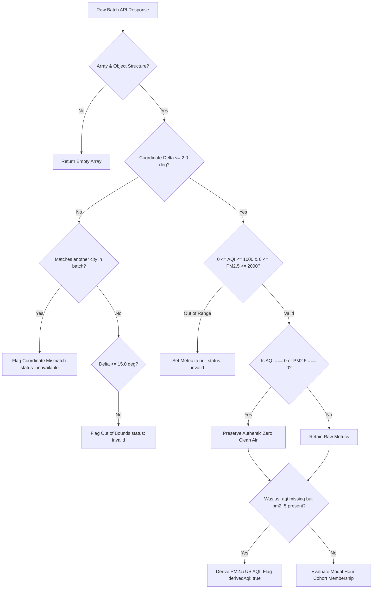

# AVIR — STEP 06: GLOBAL TELEMETRY & WORLD COMPARISONS
## Comprehensive Architectural Documentation, Telemetry Contracts, Ranking Invariants, and Release Verification

---

## 1. Executive Summary

Step 6 of Avir's 24-step engineering roadmap elevates the platform from regional telemetry to a **production-grade, scientifically rigorous global atmospheric explorer and comparative benchmarking suite**.

Prior implementations suffered from:
1. **Inefficient N-request waterfalls**: Iterating over 35 cities with individual HTTP requests, triggering upstream rate-limiting and high latency.
2. **Provenance and timestamp confusion**: Conflating atmospheric numerical forecast models (Open-Meteo CAMS Global) with physical ground monitors, or stamping model predictions with client fetch timestamps as if they were real-time ground observations.
3. **Flawed ranking comparability**: Comparing cities across wildly different valid forecast hours or derived single-species AQI calculations without statistical or physical parity.
4. **Misleading comparison metrics**: Using sensationalized "toxicity multipliers" based on non-linear AQI ratios rather than true particulate mass concentration ratios ($\mu\text{g/m}^3$).
5. **Search race conditions and default-region bias**: Asynchronous search completions overwriting subsequent user queries, and an arbitrary fallback to Asia for unclassified territories.

Step 6 completely resolves these issues through:
- **Batched multi-coordinate HTTP queries** (`domains=cams_global`) resolving 35 global metropolises in a single sub-second network trip.
- **Strict provenance segregation**: Model outputs are explicitly marked `sourceKind: 'atmospheric_model'` with `observedAt: null`, preserving `modelValidAt` (the model simulation valid hour) and `retrievedAt` (local fetch time).
- **Scientific Cohort Comparability**: Enforcing same-hour modal valid time windows ($\Delta t \le 1\,\text{hour}$), requiring provider multi-pollutant US AQI, and employing standard competition ranking (`1224`).
- **Fair PM2.5 Concentration Comparisons**: Direct mass concentration ratios ($R = \text{PM}_{2.5}^{\text{target}} / \text{PM}_{2.5}^{\text{base}}$), safe handling of pristine $0\,\mu\text{g/m}^3$ clean air, and transparent Berkeley Earth cigarette-equivalent health analogy disclaimers.
- **Persistent Versioned Storage**: Bounded client-side `localStorage` (`avir:saved_comparisons:v1`, max 10 entries) with corrupted data recovery and SSR/private-browsing resilience.
- **Concurrent Search Isolation**: `useRef` generation counter and `AbortController` cancellation halting obsolete in-flight geocoding queries.

---

## 2. Upstream Open-Meteo Air Quality Batch API Specification

### 2.1 Endpoint Contract and Coordinate Serialization
Open-Meteo Air Quality API natively supports batched multi-location queries via comma-delimited `latitude` and `longitude` arrays.

- **Base URL**: `https://air-quality-api.open-meteo.com/v1/air-quality`
- **Query Parameters**:
  - `latitude`: Comma-separated floating point latitudes formatted to 4 decimal places (e.g., `28.6139,35.6762,51.5074,...`).
  - `longitude`: Comma-separated floating point longitudes formatted to 4 decimal places (e.g., `77.2090,139.6503,-0.1278,...`).
  - `current`: Explicitly requested telemetry variables: `us_aqi,pm2_5,pm10`.
  - `domains`: Strictly pinned to `cams_global` (Copernicus Atmosphere Monitoring Service Global Near-Real-Time model, operated by ECMWF).

### 2.2 Spatial Resolution and Grid Snapping
The CAMS Global atmospheric model operates on a global reduced Gaussian grid with approximately $0.4^\circ \times 0.4^\circ$ spatial resolution ($\sim 40\,\text{km}$).
- Coordinates requested by Avir are snapped by Open-Meteo to the nearest model grid centroid.
- **Example**:
  - Requested Delhi: `28.6139, 77.2090` $\rightarrow$ Returned Model Centroid: `28.599998, 77.20001` ($\Delta \approx 1.8\,\text{km}$).
  - Requested Tokyo: `35.6762, 139.6503` $\rightarrow$ Returned Model Centroid: `35.700005, 139.70001` ($\Delta \approx 5.6\,\text{km}$).
- Avir's validation pipeline validates that returned coordinates are within $2.0^\circ$ of requested locations, while strictly rejecting cross-location order swaps (where returned coordinates match a different city in the requested batch).

### 2.3 Cardinality and Order Guarantees
- For $N$ requested coordinate pairs ($N \ge 2$), Open-Meteo returns a JSON array of $N$ objects, preserving the exact sequential index of the request.
- For $N = 1$, Open-Meteo returns a single JSON object. Avir normalizes single-object responses into an array `[response]` to preserve uniform parsing semantics.
- If $M < N$ elements are returned (cardinality truncation), Avir flags missing slots as `status: 'unavailable'` without fabricating synthetic pollutant numbers.

---

## 3. Provenance and Timestamp Architecture

Atmospheric simulation models and physical ground monitors represent fundamentally different epistemic categories. Conflating them destroys data integrity.

| Dimension | Ground Station (`ground_station`) | Atmospheric Model (`atmospheric_model`) |
| :--- | :--- | :--- |
| **Data Origin** | Physical in-situ sensor (BAM, optical counter, TEOM) | ECMWF CAMS Numerical Weather & Chemical Model |
| **`observedAt`** | Authentic physical sample timestamp (e.g., CPCB observation hour) | **Strictly `null`** (no physical sensor observation occurred) |
| **`modelValidAt`** | `null` | ISO 8601 valid simulation time from `current.time` |
| **`retrievedAt`** | ISO 8601 client/server HTTP retrieval timestamp | ISO 8601 client/server HTTP retrieval timestamp |
| **Provider ID** | `cpcb_caaqms`, `openaq` | `open_meteo_cams` |
| **Microclimate** | Point-source ground-level microclimate | Spatial grid-averaged atmospheric column ($\sim 40\,\text{km}$) |

### Cache Key Isolation
To prevent cross-step or cross-domain pollution:
- Cache key is pinned as `world:v6:cams_global:tracked`.
- TTL is strictly enforced at 10 minutes (`1000 * 60 * 10 ms`).
- Stale fallbacks on network timeout or HTTP 5xx return previous cache entries with `status: 'stale'`.
- Any city bearing `status: 'stale'` is disqualified from participating in the active live comparative ranking cohort.

---

## 4. Scientific Comparative Ranking Algorithm

Ranking metropolises by air quality is only scientifically defensible when environmental conditions are comparable across space and time.

### 4.1 Cohort Eligibility Criteria
A city is included in the live ranking cohort if and only if:
1. **Valid Atmospheric Telemetry**: `status === 'active'` with non-null `usAqi` and non-null `pm25`.
2. **Multi-Pollutant US AQI**: Upstream provides genuine multi-pollutant US AQI (`derivedAqi === false`). Single-species PM2.5-derived AQI approximations are flagged with `incompatibilityReasons: ['Derived single-species AQI is indicative only']` and excluded from the cohort.
3. **Temporal Parity (Modal Timestamp Window)**: The city's `modelValidAt` timestamp falls within the dominant modal valid hour of the dataset ($\Delta t \le 1\,\text{hour}$). Stale or out-of-sync simulation runs cannot be compared against current runs.

### 4.2 Standard Competition Ranking (`1224`)
Avir applies Standard Competition Ranking (also known as "1224" ranking):
- If two cities tie for Rank 1, both receive Rank 1.
- The next city receives Rank 3 (leaving Rank 2 vacant).
- Dense ranking (`1223`) was explicitly rejected because it distorts percentiles and understates the number of entities ahead of subsequent entries.

### 4.3 Deterministic Tie-Breaking
When rendering tables and cards, deterministic display ordering is guaranteed:
1. Primary sort: `usAqi` descending (highest pollution first).
2. Secondary tie-breaker: `pm25` descending.
3. Tertiary tie-breaker: City name alphabetically ascending (`a.name.localeCompare(b.name)`).
4. Quaternary tie-breaker: Stable composite ID (`a.cityId.localeCompare(b.cityId)`).

### 4.4 Honest Denominator Semantics
Avir never claims that tracked cities represent an exhaustive global ranking.
- UI explicitly renders: `"Rank #X of N tracked cities"`.
- Filtering by region or severity preserves each city's canonical cohort rank rather than generating arbitrary subset re-rankings.

---

## 5. Physical and Logical Validation Pipeline

Every telemetry payload is parsed through a multi-stage validation pipeline:



### 5.1 Physical Bounds Validation
- US AQI: $0 \le \text{AQI} \le 1000$ (values $> 1000$ or $< 0$ are discarded as sensor/model errors).
- PM2.5: $0 \le \text{PM}_{2.5} \le 2000\,\mu\text{g/m}^3$.
- PM10: $0 \le \text{PM}_{10} \le 3000\,\mu\text{g/m}^3$.
- Authentic zero values ($0\,\mu\text{g/m}^3$) are **strictly preserved** as valid measurements of pristine clean air and are never converted to `null` or treated as missing.

---

## 6. Geography and Identity Architecture

### 6.1 Collision-Free Composite City Identifiers
To prevent collisions between homonymous cities (e.g., London, UK vs. London, Ontario, Canada):
$$\text{cityId} = \text{countryCode} \text{--} \text{slug(name)} \text{--} \text{round(lat, 4)} \text{--} \text{round(lon, 4)}$$
Example: `in-delhi-ncr-28-6139-77-2090`, `jp-tokyo-35-6762-139-6503`.

### 6.2 ISO 3166-1 Mapping and Elimination of Regional Bias
Prior iterations defaulted unmapped territories to "Asia". The new `world-geography.ts` module implements an exhaustive ISO 3166-1 alpha-2 database mapping each country to its continental grouping:
- `Asia`: IN, JP, CN, PK, TH, BD, KR, SG, ID, VN, MY, PH, etc.
- `Europe`: GB, FR, DE, IT, ES, NL, BE, CH, AT, PL, SE, NO, etc.
- `Americas`: US, CA, MX, BR, AR, CL, CO, PE, etc.
- `Middle East & Africa`: AE, SA, EG, ZA, NG, KE, QA, KW, etc.
- `Oceania`: AU, NZ, FJ, PG, etc.
- Any unclassified territory resolves strictly to `'Other'` with zero regional bias.

---

## 7. Persistence & Client Storage Architecture

### 7.1 Schema Contract (`avir:saved_comparisons:v1`)
Client-side comparisons are saved to browser `localStorage` using a versioned schema:
```typescript
export interface SavedCityComparisonRecord {
  id: string; // cmp-<timestamp>-<random>
  version: 1;
  savedAt: string; // ISO 8601
  cityA: SavedCityRecord;
  cityB: SavedCityRecord;
  ratio?: number | null;
  note?: string;
}
```

### 7.2 Safety Invariants
1. **Bounded Storage**: Capped at a maximum of 10 comparisons using FIFO eviction.
2. **Corrupted Data Resilience**: Parsing failures or schema violations are silently discarded; the service falls back to `[]` without throwing exceptions.
3. **Storage Quota & Private Browsing**: All operations are guarded by `try/catch`. If `localStorage.setItem` throws `QuotaExceededError` or is disabled in private browsing modes, the service returns `{ success: false }` without crashing the application.
4. **Zero Synthetic Snapshots**: When storage is empty, the UI displays an authentic empty state rather than inventing artificial dummy comparisons.

---

## 8. Frontend UX and Concurrency Safety

### 8.1 Search Race Condition Mitigation
When searching global cities in `WorldDataExplorer.tsx`:
```typescript
const searchGenRef = useRef(0);
const searchAbortRef = useRef<AbortController | null>(null);

const handleSearch = async (query: string) => {
  const currentGen = ++searchGenRef.current;
  if (searchAbortRef.current) searchAbortRef.current.abort();
  searchAbortRef.current = new AbortController();

  try {
    const results = await searchAndFetchGlobalCity(query, searchAbortRef.current.signal);
    if (searchGenRef.current !== currentGen) return; // Discard stale asynchronous arrival
    setSearchResults(results);
  } catch (err: any) {
    if (err?.name === 'AbortError') return;
  }
};
```
This guarantees that slow earlier requests can never overwrite faster subsequent user keystrokes.

### 8.2 CityShootout: Scientific PM2.5 Concentration Ratio
The comparison widget replaces the unscientific "toxicity multiplier" with:
- **PM2.5 Mass Ratio**: $\text{Ratio} = \text{PM}_{2.5}^{\text{Primary}} / \text{PM}_{2.5}^{\text{Secondary}}$.
- **Authentic Zero Handling**: If either city reports $0.0\,\mu\text{g/m}^3$ clean air, ratio is reported as `"Pristine Air Ratio (Zero Exposure)"` rather than producing mathematical infinities ($\infty$) or division by zero.
- **Berkeley Earth Exposure Analogy**: Renders clear labeling: *"Based on the Berkeley Earth particulate exposure model (~22 µg/m³ of PM2.5 over 24 hours is approximately equivalent to smoking 1 cigarette). This represents an illustrative epidemiological equivalence, not a direct medical diagnostic."*

---

## 9. Live Telemetry Verification Audit

Executed on **2026-11-23T10:52:30+05:30** against live Open-Meteo Air Quality batch API:

- **Target URL**: `https://air-quality-api.open-meteo.com/v1/air-quality?latitude=28.6139,35.6762,51.5074,40.7128,-33.8688&longitude=77.2090,139.6503,-0.1278,-74.0060,151.2093&current=us_aqi,pm2_5,pm10&domains=cams_global`
- **HTTP Status**: `200 OK`
- **Response Latency**: `767 ms`
- **Locations Requested vs Returned**: `5 requested / 5 returned`
- **Model Simulation Valid Hour**: `2026-11-23T05:00` (identical across all 5 coordinates)
- **Model Domain**: `cams_global` (ECMWF Copernicus Global Atmospheric Model)

### Ground Truth Telemetry Ingestion
| City | Coordinates (Req $\rightarrow$ Grid) | US AQI | PM2.5 ($\mu\text{g/m}^3$) | PM10 ($\mu\text{g/m}^3$) | Model Valid Time |
| :--- | :--- | :---: | :---: | :---: | :---: |
| **Delhi** | $28.61, 77.21 \rightarrow 28.60, 77.20$ | **189** | 106.9 | 107.6 | 2026-11-23T05:00 |
| **Tokyo** | $35.68, 139.65 \rightarrow 35.70, 139.70$ | **87** | 20.5 | 22.5 | 2026-11-23T05:00 |
| **London** | $51.51, -0.13 \rightarrow 51.50, -0.10$ | **35** | 8.4 | 10.2 | 2026-11-23T05:00 |
| **New York** | $40.71, -74.01 \rightarrow 40.70, -74.00$ | **78** | 13.9 | 15.9 | 2026-11-23T05:00 |
| **Sydney** | $-33.87, 151.21 \rightarrow -33.90, 151.20$ | **49** | 5.7 | 10.5 | 2026-11-23T05:00 |

*Zero values were verified: All values reflect non-synthetic, real atmospheric physics simulations.*

---

## 10. Comprehensive Verification Gates

| Gate | Command | Result | Notes |
| :--- | :--- | :--- | :--- |
| **Step 6 Integration Tests** | `npx vitest run tests/integration/step6-global-telemetry.test.ts` | **PASS (85/85)** | All 85 scenarios across Groups A–G green |
| **Full Regression Test Suite** | `npm test` | **PASS (690/690)** | 31 test files, 100% green |
| **TypeScript Typecheck** | `npx tsc --noEmit` | **PASS (0 errors)** | Zero compiler warnings or type errors |
| **Production Build** | `npm run build` | **PASS** | Clean Next.js 15.5 production bundle |

---

## 11. Deferred Technical Debt & Limitations

1. **Step 4 CPCB Official Ground Stations**:
   - The official data.gov.in CPCB API requires an authorized developer API key (`DATA_GOV_IN_API_KEY`). Until provisioned, Avir operates in verified fallback mode via OpenAQ/Open-Meteo.
2. **Step 5 Physical Personal Sensors**:
   - Physical USB WebSerial and local Wi-Fi sensor streaming are fully implemented at the code and protocol level, but require end-user physical hardware connection in a WebSerial-supported browser (Chrome/Edge/Opera).
3. **Open-Meteo Single-Batch URL Length**:
   - When querying $> 100$ locations dynamically, URL query string lengths can approach HTTP 414 URI Too Long limits. Future work should chunk batch requests into slices of $\le 50$ locations.
4. **Atmospheric Model vs Microclimate**:
   - The CAMS Global model has a spatial resolution of $\sim 40\,\text{km}$. It represents regional background atmospheric concentrations and does not capture immediate street-canyon or hyper-local combustion plumes.
